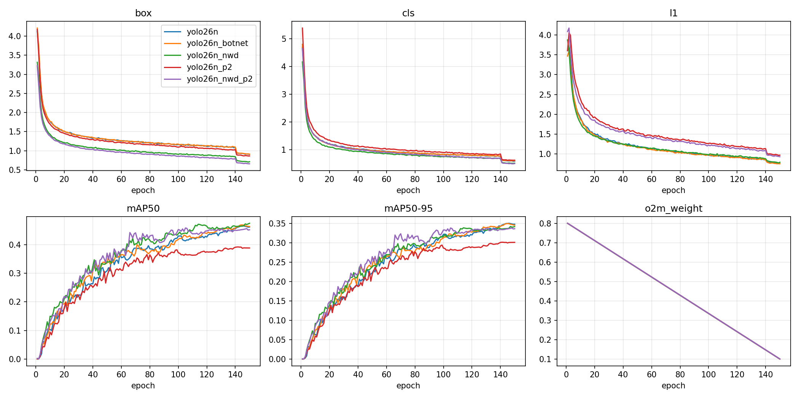
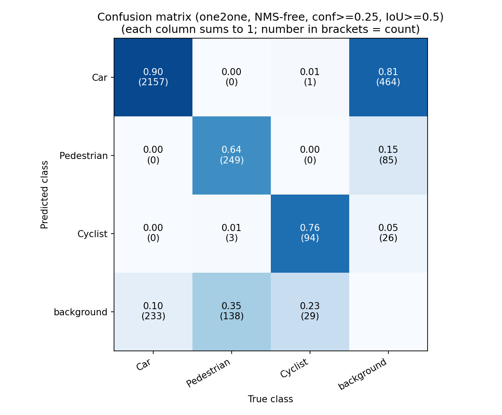
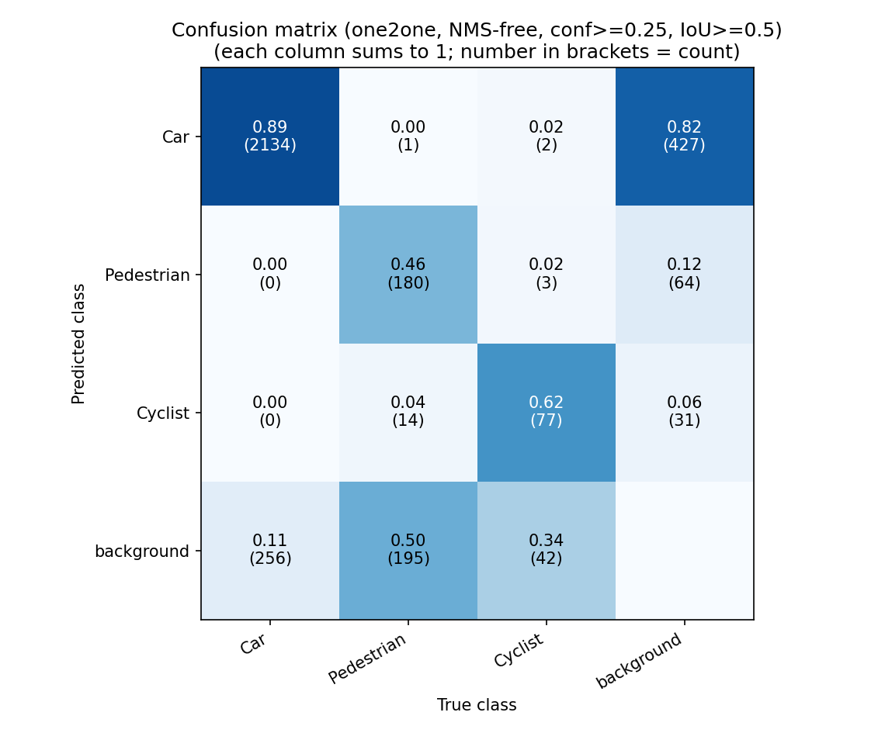
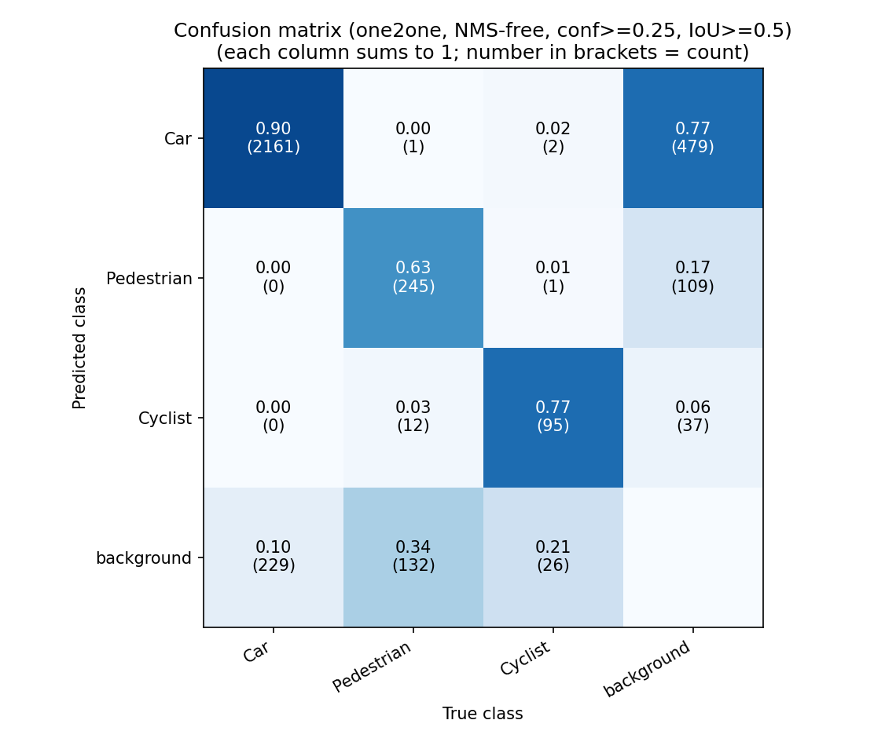

# YOLO26으로 KITTI 흑백 이미지에서 자동차·보행자·자전거 찾기

KITTI 주행 데이터셋의 흑백 이미지로 최신 객체 검출 모델 **YOLO26**을 직접 구현하고 학습했다.
먼저 **BoTNet**(attention 블록)을 적용해 봤지만 효과가 없었다. 오답을 분석해 보니 보행자가 네트워크 입력에서는 아주 작은 물체라는 게 원인이었다.
그래서 작은 물체용 방법 **NWD**와 **P2 head**를 실험했고, **NWD가 연산량 변화 없이 보행자 AP를 0.294 → 0.327로 올렸다.**

## 한눈에 보기

| 항목 | 내용 |
| --- | --- |
| 데이터 | KITTI 2D Object, 3,000장 (학습 2,400 / 검증 600), **흑백** |
| 찾는 대상 | Car(자동차), Pedestrian(보행자), Cyclist(자전거) |
| 모델 | YOLO26-n (가장 작은 크기), PyTorch로 직접 구현, 입력 832×256 |
| 실험 | ① baseline ② + BoTNet ③ + NWD ④ + P2 head ⑤ + NWD + P2 |
| 학습 환경 | Google Colab Pro (L4 GPU), 150 epoch, seed 0 |

## 결과 요약

| 모델 | 보행자 AP (NMS) | 보행자 AP (NMS 없음) | 전체 mAP50-95 (NMS) | 전체 mAP50-95 (NMS 없음) | GFLOPs | 속도 (ms/장, NMS 없음) |
| --- | --- | --- | --- | --- | --- | --- |
| YOLO26 (baseline) | 0.294 | 0.159 | 0.495 | 0.350 | 2.88 | 3.3 |
| + BoTNet | 0.293 | 0.157 | 0.496 | 0.349 | 2.87 | 3.2 |
| **+ NWD** | **0.327** | 0.156 | 0.503 | 0.342 | **2.88** | 3.2 |
| + P2 head | 0.283 | 0.111 | 0.474 | 0.301 | 4.06 | 5.0 |
| + NWD + P2 | 0.327 | 0.153 | **0.504** | 0.338 | 4.06 | 5.0 |

- AP는 COCO 방식 AP(0.5:0.95), 검증 이미지 600장 기준이다. 다섯 모델 모두 같은 L4 GPU에서 한 번에 측정했다.
- "NMS"는 one-to-many head 출력 + NMS, "NMS 없음"은 YOLO26 기본인 one-to-one head 출력이다.
- 전체 표(Car·Cyclist AP, mAP50 포함)는 [`results/small_object/compare_small.md`](results/small_object/compare_small.md)에 있다.

## 1단계: BoTNet — 효과가 없었다

모델의 깊은 부분(P5)에 있는 3×3 합성곱 일부를 **self-attention**으로 바꿨다. 이미지 전체를 보는 attention이 흑백 이미지에서 보행자·자전거를 더 잘 구분하게 해 줄 거라는 가설이었다.

**결과: mAP50-95 0.350 → 0.349, 보행자 AP 0.159 → 0.157로 사실상 같았다.**

| 오류 유형 (NMS 없음, 확신도 0.25 이상) | baseline | BoTNet |
| --- | --- | --- |
| 놓친 자동차 | 299 | 289 |
| 놓친 보행자 | 190 | 189 |
| 배경을 자동차로 착각 | 121 | 160 |
| 같은 자동차에 박스 중복 | 141 | 177 |

BoTNet은 조금 더 적극적으로 박스를 냈지만, 그만큼 잘못된 박스도 늘었다.

## 2단계: 원인 다시 찾기 — 보행자는 '작은 물체'였다

오답 분석에서 보행자 390명 중 **190명을 아예 찾지 못했다.** 다른 클래스로 헷갈린 경우는 1명뿐이었다. 문제는 구분이 아니라 **찾기** 자체였고, 그래서 전역 attention인 BoTNet이 효과가 없었다.

놓친 보행자 대부분은 원본에서 높이 40px 이상이었다. 하지만 학습 입력은 1242×375를 832×256으로 줄인 것이고(0.67배), 보행자는 폭이 높이의 약 0.4배라 얇다.

- 원본 40px 보행자 → 입력에서 약 **11×27px**
- 원본 25px 보행자 → 입력에서 약 **7×17px**
- 가장 촘촘한 검출 격자(P3)는 8px 간격 → 보행자 폭이 **격자 한 칸**

이 크기에서는 YOLO26이 학습 때 정답 칸을 고르는 점수(TAL의 CIoU⁶)가 1~2px 어긋남에도 거의 0이 된다. 7×18px 보행자는 2px만 어긋나도 이 점수가 0.03이다. 그래서 두 가지 가설을 세웠다.

| 가설 | 검증 방법 |
| --- | --- |
| **점수 가설:** 작은 박스에서 IoU 점수가 불안정해 정답 배정에서 밀린다 | **NWD**로 점수 교체 |
| **해상도 가설:** stride 8 특징맵에서는 얇은 물체 정보가 뭉개진다 | **P2 head**(stride 4) 추가 |

## 3단계: NWD와 P2 head

| 방법 | 바꾸는 것 | 켜는 법 |
| --- | --- | --- |
| **NWD** ([Wang et al., 2021](https://arxiv.org/abs/2110.13389)) | 박스를 2D 가우시안으로 보고 분포 사이 거리로 유사도를 잰다. 정답 배정(TAL)과 box loss에서 CIoU의 절반을 NWD로 바꿨다. 상수 C는 보행자 평균 크기로 자동 계산된다(42.8px). | `assign.nwd_ratio=0.5 loss.nwd_ratio=0.5` |
| **P2 head** ([FPN](https://arxiv.org/abs/1612.03144), [TPH-YOLOv5](https://arxiv.org/abs/2108.11539), [MST-YOLO](https://doi.org/10.3390/s24227347)) | stride 4 검출층을 추가해 격자를 2배 촘촘하게 한다. 검출 head 3개 → 4개, 예측 칸 약 4배. | `model.p2=true` |

**입력 해상도 기준 박스 폭별 보행자 recall (NMS 없음)**

| 모델 | 폭 < 8px (28명) | 폭 8–16px (104명) | 폭 ≥ 16px (258명) | 놓친 보행자 |
| --- | --- | --- | --- | --- |
| baseline | 0.04 | 0.40 | 0.61 | 190 |
| + BoTNet | 0.11 | 0.37 | 0.62 | 189 |
| **+ NWD** | 0.18 | **0.60** | **0.69** | **144** |
| + P2 head | 0.04 | 0.27 | 0.57 | 215 |
| + NWD + P2 | 0.32 | 0.58 | 0.67 | 149 |

| 혼동행렬 — NWD | 혼동행렬 — P2 head | 혼동행렬 — NWD + P2 |
| --- | --- | --- |
|  |  |  |

baseline과 BoTNet 혼동행렬은 [`results/confusion_matrix_baseline.png`](results/confusion_matrix_baseline.png), [`results/confusion_matrix_botnet.png`](results/confusion_matrix_botnet.png)에 있다.

### 알게 된 점

1. **점수 가설이 맞았다.** NWD는 연산량 변화 없이 격자 한두 칸 크기(8–16px) 보행자 recall을 0.40 → 0.60으로 올렸고, 놓친 보행자를 190 → 144명(−24%)으로 줄였다. 원본 25px 미만 자동차 recall도 0.71 → 0.80으로 올라, 효과가 클래스가 아니라 크기를 따라간다.
2. **해상도 가설은 이번 조건에서 확인되지 않았다.** P2 head 단독은 보행자 AP가 0.283으로 오히려 떨어졌다. 예측 칸이 4배로 늘었는데 학습 이미지는 2,400장뿐이라 충분히 학습되지 못한 것으로 보인다. NWD와 함께 쓰면 NWD 단독과 성능이 같고 연산만 41% 더 든다.
3. **찾는 것은 늘었지만 박스는 덜 정확해졌다.** NWD에서 보행자 위치 오류가 22 → 29건, 배경 오검출이 16 → 25건으로 늘었다. C = 42.8px가 논문(12.8px)보다 커서 위치 어긋남에 관대해진 탓으로 보인다.
4. **NMS 없는 출력은 여전히 약하다.** NWD의 개선은 NMS 출력에서만 AP로 나타났다. one-to-one head는 정답 하나당 예측 하나만 배워서, 작은 데이터·짧은 학습에서 덜 학습된다.
5. **시드가 하나다.** 모든 실험을 한 번씩만 돌렸다. NWD의 +0.033은 BoTNet의 차이(0.001~0.006)보다 크지만, 반복 실험으로 확인이 필요하다.

## 후속 연구

| 순서 | 할 일 | 근거 (이번 결과) | 방법 |
| --- | --- | --- | --- |
| 1 | **NWD 박스 정밀도 회복** | 위치 오류 22 → 29건, C = 42.8px로 관대함 | C를 12.8px 또는 보행자 크기 중앙값으로, loss 쪽 비율만 0.5 → 0.25로 |
| 2 | **one-to-one head 강화** | NMS 없는 보행자 AP가 제자리 (NMS와 0.171 차이) | DEIM(Dense O2O) 같은 one-to-one 학습 보강, `model.o2o_detach=false` |
| 3 | **시드 3개 반복** | 모든 실험이 seed 1개 | baseline과 NWD를 `train.seed=1`, `2`로 반복해 평균 ± 표준편차 |
| 4 | **더 오래, 더 많은 데이터로 학습** | 150 epoch에도 점수가 오르고, P2 head는 데이터 부족으로 역효과 | `train.epochs=300`, KITTI 전체 7,481장으로 P2 head 재검증 |
| 5 | **KITTI 공식 기준으로 평가** | 지금은 COCO 기준이라 다른 KITTI 논문과 비교가 어렵다 | Easy / Moderate / Hard 난이도별, Car는 IoU 0.7 기준 |
| 6 | **LiDAR 3D 검출 (별도 실험)** | 2D와 따로 진행하기로 함 | PointPillars로 KITTI LiDAR 3D 검출 (`pointpillars/`, 작업 중) |

## 실행 방법 (Colab)

1. 이 저장소를 zip으로 받아 Google 드라이브 `내 드라이브`에 `yolo26-kitti.zip`이라는 이름으로 올린다.
2. [KITTI 홈페이지](https://www.cvlibs.net/datasets/kitti/eval_object.php)에서 `data_object_image_2.zip`, `data_object_label_2.zip`을 받아 드라이브에 같이 올린다.
3. `colab/YOLO26_KITTI_colab.ipynb`를 Colab에서 열고, GPU를 켠 뒤 셀을 위에서부터 차례로 실행한다.
   - 5번: baseline, BoTNet 셀: BoTNet
   - 12번: NWD, 13번: P2 head, 14번: NWD + P2
   - 15번: 비교표·학습 곡선, 16번: 오답 분석(폭별 recall 포함)

## 폴더 구성

| 폴더 / 파일 | 설명 |
| --- | --- |
| `colab/` | Colab 실행 노트북 (데이터 준비 → 학습 → 평가 → 비교) |
| `yolo26/` | 모델, 학습, 평가 코드 (NWD: `utils.py`·`assigner.py`·`loss.py`, P2 head: `model.py`) |
| `configs/` | 학습 설정 (epoch, 학습률, `nwd_ratio`, `p2` 등) |
| `tools/` | 데이터 변환, 오답 분석, 결과 비교 도구 |
| `results/` | 1단계(baseline, BoTNet) 결과 표와 그림 |
| `results/small_object/` | 3단계(NWD, P2 head) 결과: 실험별 `results.csv`, 설정, 혼동행렬, 오답 분석 |
| `pointpillars/` | LiDAR 3D 검출 (PointPillars, 작업 중) |
| `docs/` | 구현 설명, 참고 논문 정리, NWD·P2 head 학습 노트(`YOLO26_NWD_P2_study.pdf`) |

## 참고 자료

- YOLO26 — https://arxiv.org/abs/2606.03748
- BoTNet (Srinivas et al., CVPR 2021) — https://arxiv.org/abs/2101.11605
- NWD (Wang et al., 2021) — https://arxiv.org/abs/2110.13389 · 코드 https://github.com/jwwangchn/NWD
- FPN (Lin et al., CVPR 2017) — https://arxiv.org/abs/1612.03144
- TPH-YOLOv5 (Zhu et al., ICCV Workshops 2021) — https://arxiv.org/abs/2108.11539
- MST-YOLO (Li et al., Sensors 2024) — https://doi.org/10.3390/s24227347
- KITTI 데이터셋 (Geiger et al., CVPR 2012) — https://www.cvlibs.net/datasets/kitti/
- 구현 시 참고한 코드: [ultralytics/ultralytics](https://github.com/ultralytics/ultralytics) (AGPL-3.0)

결과 이미지는 KITTI Vision Benchmark Suite의 이미지를 사용했다 (CC BY-NC-SA 3.0).
