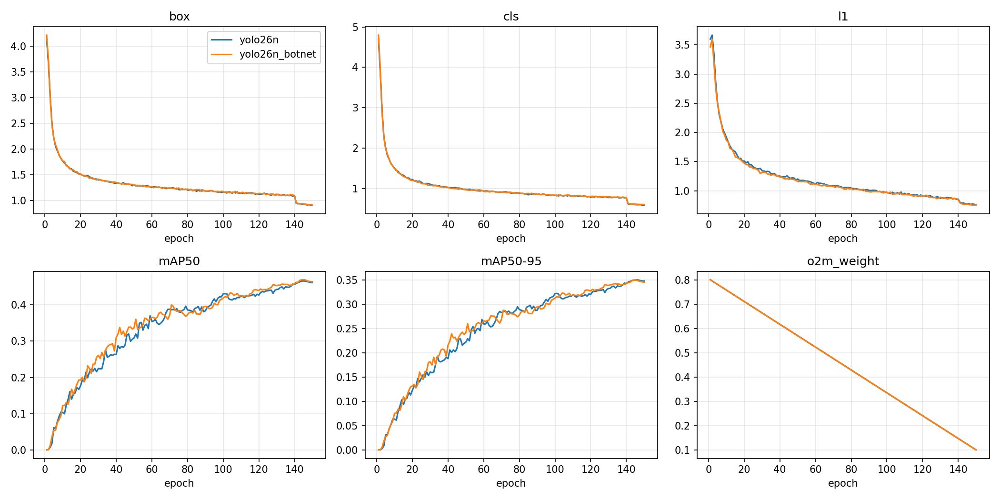
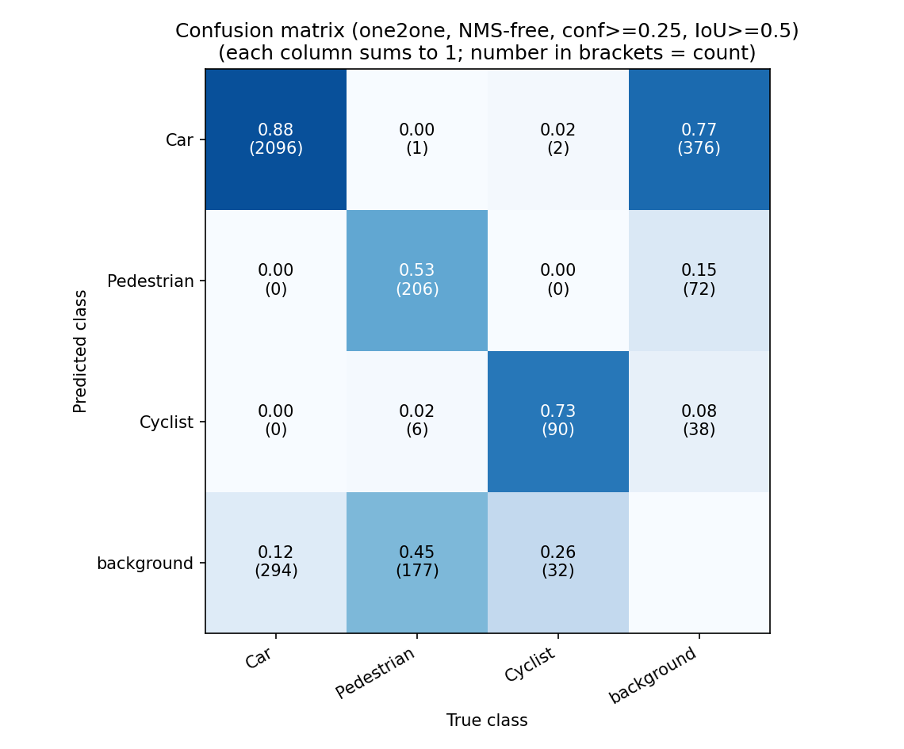
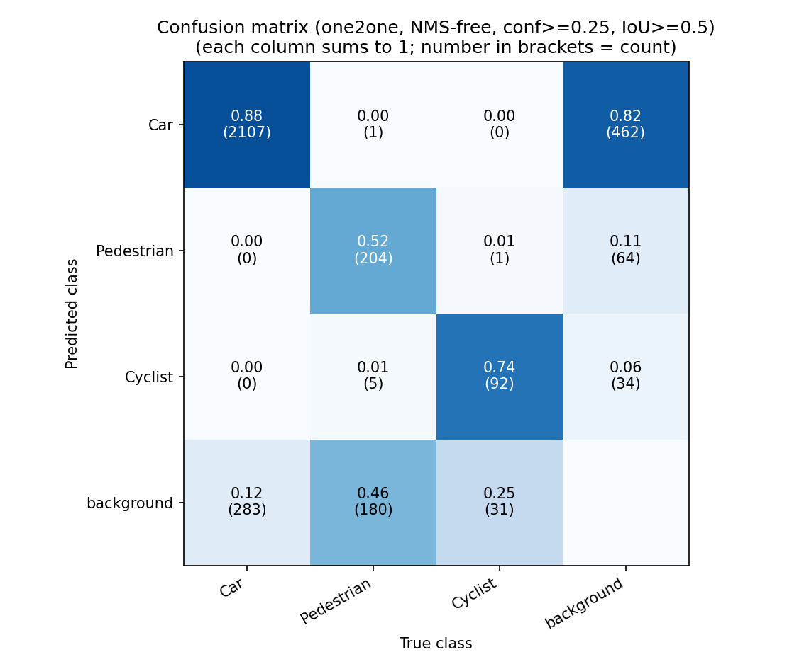

# YOLO26으로 KITTI 흑백 이미지에서 자동차·보행자·자전거 찾기

KITTI 주행 데이터셋의 흑백 이미지로 최신 객체 검출 모델 **YOLO26**을 직접 구현하고 학습했다.
그리고 YOLO26에 **BoTNet**(attention 블록)을 적용한 버전과 성능을 비교했다.

## 한눈에 보기

| 항목 | 내용 |
| --- | --- |
| 데이터 | KITTI 2D Object, 3,000장 (학습 2,400 / 검증 600), **흑백** |
| 찾는 대상 | Car(자동차), Pedestrian(보행자), Cyclist(자전거) |
| 모델 | YOLO26-n (가장 작은 크기), PyTorch로 직접 구현 |
| 비교 실험 | YOLO26 (baseline) vs YOLO26 + BoTNet |
| 학습 환경 | Google Colab Pro GPU, 150 epoch (모델당 약 2.9시간) |

## 결과

**BoTNet을 적용해도 전체 성능은 거의 같았다.** 대신 BoTNet 모델이 파라미터가 약간 적고 조금 더 빨랐다.

| 모델 | 추론 방식 | mAP50 | mAP50-95 | Car | Pedestrian | Cyclist | 속도 (ms/장) |
| --- | --- | --- | --- | --- | --- | --- | --- |
| YOLO26 (baseline) | NMS 없음 | 0.466 | 0.350 | 0.613 | 0.159 | 0.278 | 1.6 |
| YOLO26 + BoTNet | NMS 없음 | 0.469 | 0.349 | 0.624 | 0.157 | 0.266 | 1.4 |
| YOLO26 (baseline) | NMS 사용 | 0.710 | 0.495 | 0.732 | 0.294 | 0.458 | 2.0 |
| YOLO26 + BoTNet | NMS 사용 | 0.704 | 0.496 | 0.732 | 0.293 | 0.463 | 1.9 |

클래스 열은 클래스별 AP(0.5:0.95)다. 검증 이미지 600장, 두 모델 모두 같은 Colab GPU에서 측정했다. 파라미터 수는 baseline 2.49M, BoTNet 2.39M이다.

**오류 유형 비교 (NMS 없음, 확신도 0.25 이상)**

| 항목 | baseline | BoTNet | 해석 |
| --- | --- | --- | --- |
| 놓친 자동차 | 299 | 290 | BoTNet이 조금 더 많이 찾음 |
| 놓친 자전거 | 35 | 31 | BoTNet이 조금 더 많이 찾음 |
| 배경을 자동차로 착각 | 121 | 160 | BoTNet이 더 많이 착각 |
| 같은 자동차에 박스 중복 | 140 | 177 | BoTNet이 더 많음 |
| 작은 자동차(25px 미만) 찾은 비율 | 0.71 | 0.73 | 비슷 |
| 중간 크기 자전거(25~40px) 찾은 비율 | 0.56 | 0.74 | BoTNet이 높음 (표본 27개) |

BoTNet은 이미지 전체를 보는 attention 덕분에 더 적극적으로 물체를 찾았다. 그만큼 잘못 찾은 박스도 늘었다.

| 혼동행렬 — baseline | 혼동행렬 — BoTNet |
| --- | --- |
|  |  |

많이 틀린 이미지 예시는 [`results/errors_top_baseline.png`](results/errors_top_baseline.png)와 [`results/errors_top_botnet.png`](results/errors_top_botnet.png)에 있다.

### 알게 된 점

1. **BoTNet의 효과는 오차 범위 안이었다.** mAP50-95 차이가 0.006 이하로, 시드 하나로 한 번씩만 실험한 결과로는 차이가 있다고 말하기 어렵다.
2. **보행자가 가장 어렵다.** 보행자 AP는 0.16으로 가장 낮다. 40px 이상인 큰 보행자도 절반 가까이 놓쳤다.
3. **NMS 없는 출력이 아직 약하다.** NMS를 쓴 결과보다 mAP50-95가 약 0.145 낮다. 논문(COCO)에서는 이 차이가 0.008 정도였다. 150 epoch에도 점수가 계속 오르고 있었으므로(최고점 145~146 epoch), 학습이 덜 끝난 것으로 보인다.

## YOLO26이란?

YOLO는 이미지를 한 번만 보고 물체의 위치와 종류를 동시에 찾는 모델이다. YOLO26은 2026년에 나온 최신 버전이다.
이전 버전보다 구조가 단순해져서 빠르고, 결과를 내기 위한 후처리(NMS)가 필요 없다.
작은 물체를 더 잘 학습하도록 정답을 배정하는 방식도 개선됐다.

## BoTNet이란?

모델의 깊은 부분에 있는 3×3 합성곱(convolution) 일부를 **self-attention**으로 바꾼 구조다.
합성곱은 주변 픽셀만 보지만, attention은 이미지 전체를 한 번에 볼 수 있다.
이 실험에서는 YOLO26의 다른 부분은 그대로 두고 이 블록만 바꿔서, BoTNet이 성능에 주는 영향을 확인했다.

## 후속 연구

이번 결과에서 드러난 문제를 기준으로, 효과가 클 것 같은 순서대로 정리했다.

| 순서 | 할 일 | 왜 필요한가 (이번 결과) | 방법 |
| --- | --- | --- | --- |
| 1 | **더 오래, 더 많은 데이터로 학습** | 150 epoch에도 점수가 계속 올랐고, NMS 없는 출력이 NMS보다 0.145 낮다 | `train.epochs=300`, 또는 KITTI 전체 7,481장 사용 |
| 2 | **같은 실험을 시드 3개로 반복** | BoTNet 차이(0.006)가 진짜인지 판단할 수 없다 | `train.seed=1`, `train.seed=2`로 반복해 평균 ± 표준편차로 비교 |
| 3 | **보행자 성능 개선** | 보행자 AP가 0.16으로 가장 낮고, 큰 보행자도 절반을 놓쳤다 | 입력 해상도 올리기(`train.imgsz=[384,1248]`), 아주 작은 물체용 출력층(P2, stride 4) 추가, 보행자 이미지 비중 늘리기 |
| 4 | **NMS 없는 head 강화** | one-to-one head가 덜 학습됐다 | `model.o2o_detach=false`로 backbone까지 학습 신호 전달, ProgLoss 시작 비율 바꾸기 |
| 5 | **BoTNet 오검출 줄이기** | BoTNet에서 배경 오검출(121 → 160)과 중복 박스가 늘었다 | BoTNet 위치를 바꿔 보기(P4 단계), 기존 attention(C2PSA)과 겹치지 않게 하나만 쓰기 |
| 6 | **입력 정보 늘리기** | 흑백이라 색 정보가 없다 | 컬러 입력(`model.in_channels=3`), LiDAR 점을 이미지에 투영한 깊이 채널 추가 |
| 7 | **KITTI 공식 기준으로 평가** | 지금은 COCO 기준이라 다른 KITTI 논문과 비교가 어렵다 | Easy / Moderate / Hard 난이도별, Car는 IoU 0.7 기준으로 평가. 주행(sequence) 단위로 train/val 나누기 |
| 8 | **사전학습 가중치 사용** | 처음부터 학습해서 데이터가 적을 때 불리하다 | COCO로 학습된 가중치에서 시작해 KITTI로 미세조정 |

이번 실험에서는 시간 제약으로 1, 2번을 하지 못했다. 이 두 가지를 먼저 해야 BoTNet 효과를 확실하게 판단할 수 있다.

## 진행 중: 작은 보행자 개선 (NWD · P2 head)

오답 분석에서 놓친 보행자는 원본에서는 40px 이상이 많지만, 832×256으로 줄인 입력에서는 **폭이 7~11px**로 검출 격자(stride 8) 한 칸 정도다.
이 크기에서는 YOLO26이 정답 칸을 고를 때 쓰는 CIoU 점수가 1~2px 어긋남에도 크게 떨어진다. 그래서 두 가지를 따로 실험한다.

| 실험 | 바꾸는 것 | 켜는 법 | 연산량 |
| --- | --- | --- | --- |
| B. NWD | 정답 고르기(TAL)와 box loss에서 CIoU의 절반을 **NWD**(박스를 가우시안으로 보고 거리를 잰 값)로 바꿈 | `assign.nwd_ratio=0.5 loss.nwd_ratio=0.5` | 2.88 GFLOPs (그대로) |
| C. P2 head | stride 4 검출층을 추가해 격자를 2배 촘촘하게 | `model.p2=true` | 4.06 GFLOPs |

- NWD 상수 C는 학습 데이터에서 가장 작은 클래스(보행자)의 평균 크기로 자동 설정된다 (`assign.nwd_C: auto`).
- 오답 분석(`tools/analyze_errors.py`)에 **입력 해상도 기준 박스 폭별 recall** 표(<8px / 8–16px / ≥16px)를 추가했다. 두 방법은 앞의 두 칸을 올리는 것이 목표다.
- 참고 논문: NWD (arXiv 2110.13389), MST-YOLO (Sensors 2024), SOD-YOLO (arXiv 2507.12727), SDD-YOLO (arXiv 2603.25218). 정리는 [`docs/papers.md`](docs/papers.md).

## 실행 방법 (Colab)

1. 이 저장소를 zip으로 받아 Google 드라이브 `내 드라이브`에 `yolo26-kitti.zip`이라는 이름으로 올린다.
2. [KITTI 홈페이지](https://www.cvlibs.net/datasets/kitti/eval_object.php)에서 `data_object_image_2.zip`, `data_object_label_2.zip`을 받아 드라이브에 같이 올린다.
3. `colab/YOLO26_KITTI_colab.ipynb`를 Colab에서 열고, GPU를 켠 뒤 셀을 위에서부터 차례로 실행한다.

## 폴더 구성

| 폴더 / 파일 | 설명 |
| --- | --- |
| `colab/` | Colab 실행 노트북 (데이터 준비 → 학습 → 평가 → 비교) |
| `yolo26/` | 모델, 학습, 평가 코드 |
| `configs/` | 학습 설정 (epoch, 학습률 등) |
| `tools/` | 데이터 변환, 오답 분석, 결과 비교 도구 |
| `results/` | 실험 결과 표와 그림 |
| `docs/` | 자세한 구현 설명과 참고 논문 정리 |

자세한 구현 내용은 [`docs/implementation.md`](docs/implementation.md)에, 참고 논문은 [`docs/papers.md`](docs/papers.md)에 정리했다.

## 참고 자료

- Ultralytics YOLO26 논문 — https://arxiv.org/abs/2606.03748
- BoTNet 논문 (Srinivas et al., CVPR 2021) — https://arxiv.org/abs/2101.11605
- KITTI 데이터셋 (Geiger et al., CVPR 2012) — https://www.cvlibs.net/datasets/kitti/
- 구현 시 참고한 코드: [ultralytics/ultralytics](https://github.com/ultralytics/ultralytics) (AGPL-3.0)

결과 이미지는 KITTI Vision Benchmark Suite의 이미지를 사용했다 (CC BY-NC-SA 3.0).
